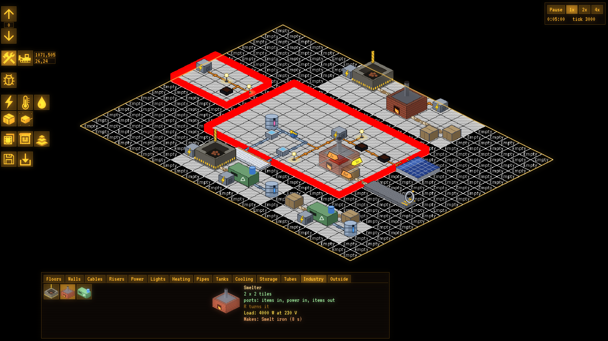
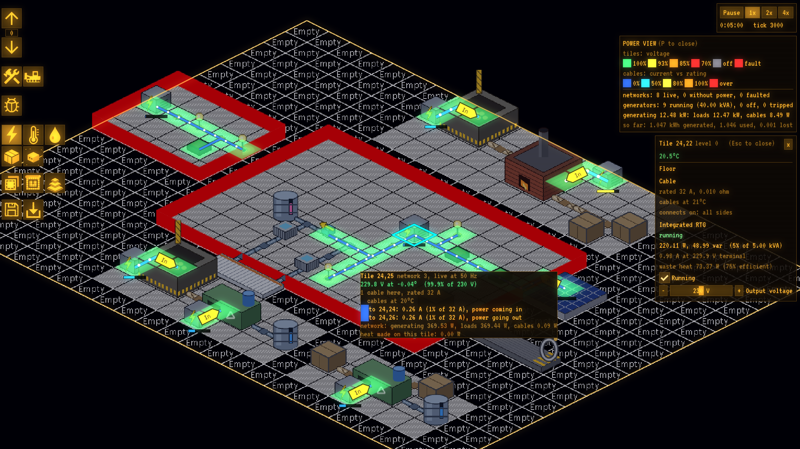
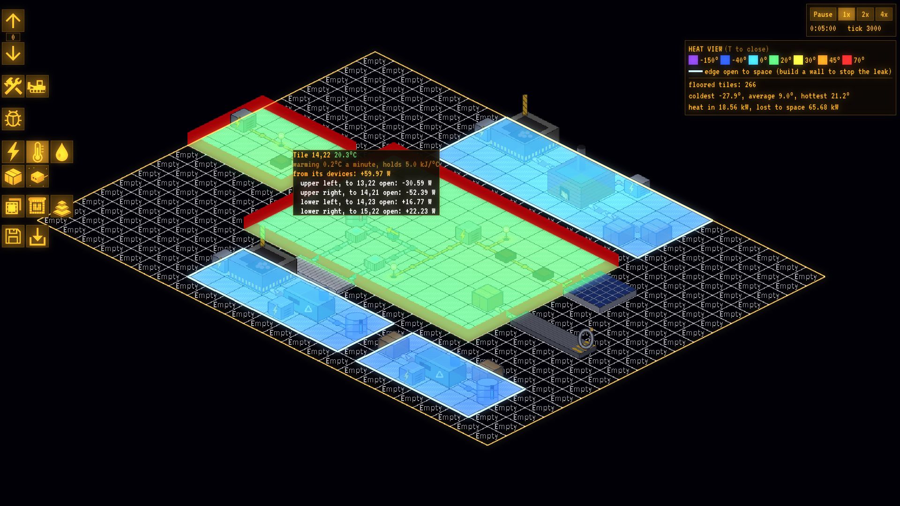
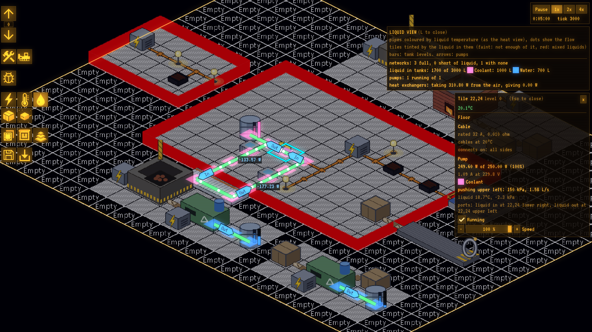
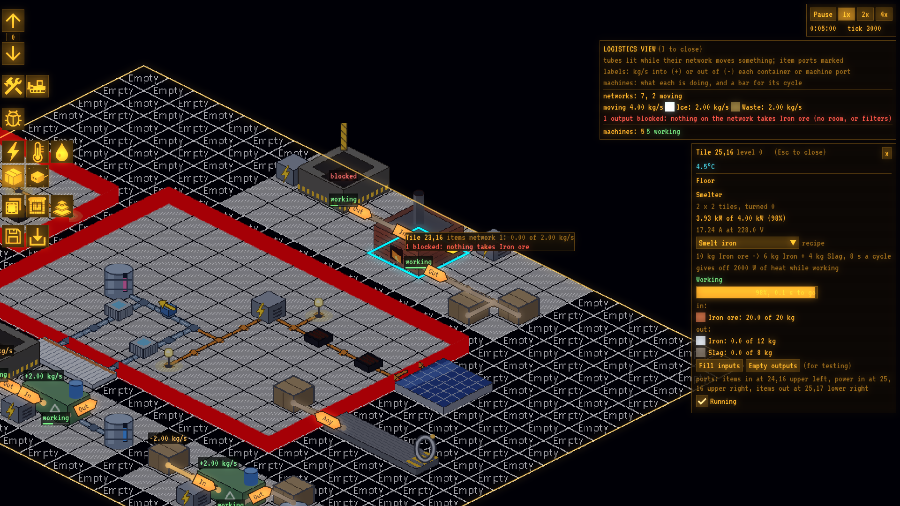
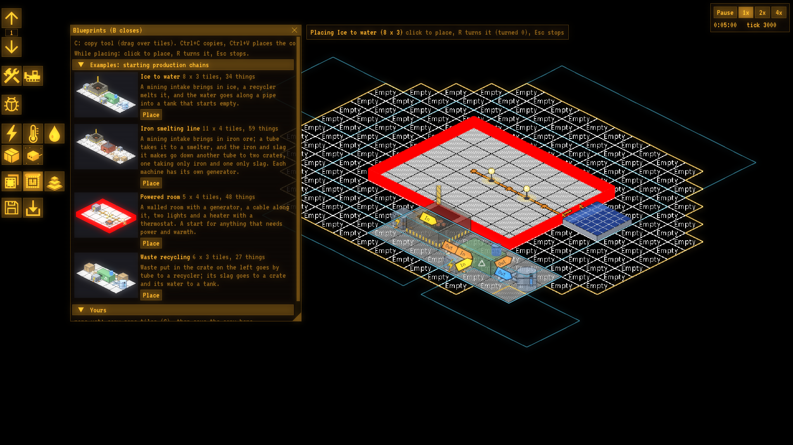
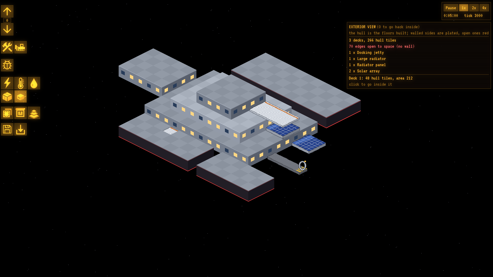
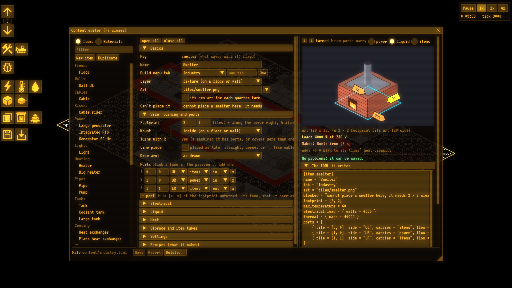

# StationBuilder

An isometric space-station builder in C++, using SFML and Dear ImGui. You lay out decks, rooms and machines tile by
tile, and the station runs: power flows through the cables, rooms warm and cool, coolant carries heat out to
radiators, and machines turn ore into metal.

The end goal is a space trading and empire game. The player will run several space stations, outposts and planetary
bases, plus a fleet of spacecraft, and build all of them in the same tile editor.

> Early development. The world's art is placeholder
>

## Highlights

### Build a station

- Floors, walls, cables, pipes, item tubes and machines, placed tile by tile. Cables and pipes join their neighbours
  on their own, or can be given a fixed shape.
- Machines can cover several tiles and turn with R. Their ports (power, liquid, items; in, out or any) show on the
  placement preview.
- Click a tile to open its panel: live readings, settings (switches, voltages, thermostats, recipes) and controls.

### Electrical simulation

- Each tick solves the AC network as phasors with a sparse solver (Eigen), so cable resistance, voltage drop,
  reactive power and power factor all count.
- An overloaded generator sags, then trips after a few seconds and needs a reset. Generators at different frequencies
  on one network fault it.
- The power view (P) colours tiles by voltage and cables by current against their rating. Hover a tile for its
  voltage, currents and network totals.

### Heat

- Every floored tile holds air that warms and cools. Walls insulate; an open edge loses heat to space.
- Heaters have thermostats, generators give off waste heat and derate when hot, and loaded cables warm up.
- The heat view (T) shows each tile's temperature, the heat crossing each of its sides, and every edge open to space.

### Liquids and cooling

- Pipes, pumps, tanks and heat exchangers, with pressures and flows solved each tick and the liquid's temperature
  carried along with the flow.
- Radiators on the hull shed heat to space as εσA(T⁴ − Tₛ⁴).
- The liquid view (L) shows the flow, tank levels, pumps and what each heat exchanger is doing.

### Industry and logistics

- Materials have a mass and density. Machines (mining intake, smelter, recycler) run recipes and need power.
- Item tubes carry materials between machine ports and crates, and a crate can be set to take only one material.
- The logistics view (I) shows what each tube moves, what each machine is doing, and where an output is blocked.

### Blueprints, copy and paste

- C selects tiles, Ctrl+C copies them and Ctrl+V pastes. Copies keep their settings, and R turns them.
- Save a copy as a blueprint from the Blueprints menu (B). Each one is a TOML file you can share.
- Four starting production chains come with the game: Ice to water, Iron smelting line, Powered room and Waste
  recycling.

### Decks and the outside

- Stack decks of any shape: the floors you build are the hull. Risers carry cables, pipes, air and item tubes between
  decks.
- The exterior view (O) shows the whole station from outside, with the solar arrays, radiators and docking jetties
  mounted on its hull.

### Content editor

- Every item, material and recipe is defined in TOML files in [StationBuilder/content/](StationBuilder/content/).
  You can add your own without touching the code, and F5 reloads them while the game runs.
- F6 lists what loaded and any problems. F7 opens an in-game editor that writes the files for you, with a live
  preview of the art and ports.

### A terminal-style GUI

- Dear ImGui themed like an old terminal Elite Dangerous style.

## Controls

| Input | What it does |
| --- | --- |
| Right mouse drag, mouse wheel | Move and zoom the view |
| Left click | Place, bulldoze, or select a tile, depending on the mode |
| Buttons on the left | Build mode, bulldoze, views, copy, blueprints, decks, exterior, save and load |
| Space, 1, 2, 3 | Pause, and run at 1x, 2x or 4x speed |
| Page Up, Page Down | The deck above or below |
| R, Shift+R | Turn what you are placing; change a cable's or pipe's shape |
| Delete | Bulldoze mode |
| P, T, L, I | Power, heat, liquid and logistics views |
| O, D | Exterior view; Decks panel |
| C, Ctrl+C, Ctrl+V, B | Copy tool, copy, paste, Blueprints menu |
| Esc | Step back out of the current tool |
| F5, F6, F7 | Reload content, content panel, content editor |
| F8, Shift+F8 | Screen effects on or off; amber or orange |
| Ctrl +, Ctrl - | GUI size |

## Building

Windows with MSVC (Visual Studio 2022 or its Build Tools), CMake 3.21 or newer, and Ninja.

1. Install SFML 2.6 to `%USERPROFILE%\source\SFML`. Build Boost 1.87 (serialization and filesystem) staged at
   `%USERPROFILE%\source\boost_1_87_0\stage`. To use other locations, change `CMAKE_PREFIX_PATH` in
   [CMakePresets.json](CMakePresets.json).
2. Build with `cmake --preset debug` then `cmake --build build/debug`. CMake downloads Dear ImGui, ImGui-SFML, Eigen
   and toml++ itself.
3. Run the game from the `StationBuilder/` folder, which holds its art, content and fonts. The VS Code launch
   configuration does this.

The screenshots above come from [tools/readmeShots.cpp](tools/readmeShots.cpp). It builds a station from the example
blueprints, runs it for five minutes of game time, and draws each view in a hidden window. To redraw them after a
change, build it with `cmake --build build/debug --target ReadmeShots` and run `..\build\debug\ReadmeShots.exe` from
the `StationBuilder/` folder. In VS Code, use the "README screenshots" launch configuration.

## Roadmap

**Implemented**

- The isometric tile engine, building, saving and loading
- Electrical, heat and liquid simulations, sharing one tick and one network solver
- Content defined in files, with recipes, item logistics and an in-game editor
- Blueprints, copy and paste
- Placeholder machines, with a lot of their recipes not related to a off-planet base. Lore writing to help steer what these machines are their technologies
- Decks of any shape, the exterior view, and equipment mounted on the hull

**Next**
- Background universe, lore and justification
- Designable ships that require systems, power, cooling.
- An electro-magnetic emissions simulation that punishes players for lazy and inefficient designs. 
- FTL and sub-light travel mechanics that require dedicated ship's system.
- Multiple tiers of FTL travel that balance between speed, fuel usage and emissions. 
  "Silent slip is loud traversal"
  "Silent traversal is a shallow noisy slip"
  Slip depth: skim, shallow, middle, deep. The deeper the slip the lower the travel emissions, but more power consumption. Deeper slips require heavier traversals which produce the most emissions. Large fast ships travel silently but announce their arrival/departure. Skimmers have <1c capability but faster than sublight
- Planetary simulation with land and orbital based resource extraction
- Saving the simulation's state: temperatures, tank contents and generator trips
- More electrical parts to support the (breakers, batteries, transformers, power electronics)
- Liquids that freeze and boil, and machines cooled directly by liquid
- Building from the exterior view, and growing the station's grid
- Art for the world, to match the GUI

**Further out:** the trading and empire game itself, with several stations, outposts, planetary bases and a fleet.

## Credits

- [VT323](StationBuilder/fonts/VT323-OFL.txt) font by Peter Hull, under the SIL Open Font License 1.1.
- Built with [SFML](https://www.sfml-dev.org/), [Dear ImGui](https://github.com/ocornut/imgui),
  [ImGui-SFML](https://github.com/SFML/imgui-sfml), [Eigen](https://eigen.tuxfamily.org/),
  [toml++](https://marzer.github.io/tomlplusplus/) and [Boost](https://www.boost.org/).
